<div align="center">
  <h3><code>aakash@github ~/FarmSync $ ./banner.sh</code></h3>
  
  <p><code>High yield crop prediction using quantum AI</code></p>

  <br><br>

  <h3><code>aakash@github ~/FarmSync $ cat about.txt</code></h3>
  <p>A digital guidebook for new farmers in Tamil Nadu. Enter your land and soil readings and it returns the crops that will grow there, the order to plant them across the year, and what the soil needs first. The order comes from a QAOA circuit, not a sort: a crop's value depends on what was planted before it, so the best order is rarely the ranked one. <a href="PRD.md">PRD</a> and <a href="TRD.md">TRD</a> have the numbers.</p>

  <br><br>

  <h3><code>aakash@github ~/FarmSync $ ./stack.sh</code></h3>
  <p>
    &nbsp;
    &nbsp;
    &nbsp;
    &nbsp;
    &nbsp;
    &nbsp;
    &nbsp;
    &nbsp;
    
  </p>

  <br><br>

  <h3><code>aakash@github ~/FarmSync $ ./run.sh</code></h3>
</div>

```bash
git clone https://github.com/Aakashxnoir/FarmSync.git
cd FarmSync/backend
python -m venv .venv && source .venv/bin/activate
pip install -r requirements.txt
cp .env.example .env
python -m scripts.build_training_set && python -m scripts.train_model
python -m scripts.seed_demo            # optional: 3 demo farms, set DEV_LOGIN_USER / DEV_LOGIN_TOKEN in .env
uvicorn app.main:app --reload

cd ../flutter_app
flutter run --dart-define=API_BASE_URL=http://10.0.2.2:8000             # Android emulator
flutter run -d chrome --dart-define=API_BASE_URL=http://localhost:8000  # web
```

<div align="center">
  <br>
  <h3><code>aakash@github ~/FarmSync $ ./links.sh</code></h3>
  <p>
    <a href="https://aakash-portfolio-navy.vercel.app"></a>&nbsp;
    <a href="https://github.com/Aakashxnoir"></a>
  </p>
  <br>
</div>
