<p align="center">
  
</p>

<p align="center">
  <code>flutter 3.47</code>&nbsp;
  <code>dart</code>&nbsp;
  <code>fastapi</code>&nbsp;
  <code>lightgbm</code>&nbsp;
  <code>pennylane</code>&nbsp;
  <code>clerk</code>&nbsp;
  <code>sqlalchemy</code>&nbsp;
  <code>railway · vercel</code>
</p>

<p align="center"><b>Live:</b> <a href="https://farmsync-tan.vercel.app">farmsync-tan.vercel.app</a></p>

Most crop advisors sort crops by profit. **FarmSync searches for the order.**

It's a digital guidebook for new farmers in Tamil Nadu. A farmer signs in with
Google, adds a farm with its location, size and Soil Health Card readings, and
the app tells them which crops will grow there, the order to plant them across
**Kharif, Rabi and Summer**, and what the soil needs first: bags of urea, DAP and
MOP, pH correction and irrigation.

The order is the hard part. A cereal earns more after a legume and less after
itself, so the best plan for the year is rarely the three best crops sorted.
FarmSync hands that one step to a **12-qubit QAOA circuit** and keeps everything
else classical.


## A year's plan from one soil card

<p align="center">
  
</p>

These are the web build at phone size, running on the three seeded Thanjavur
demo farms. Every figure comes from the real pipeline. Satellite NDVI was off
for the captures, so the app ran in its degraded mode on soil and weather alone.

|  |  |
|---|---|
| **Farms** | every farm on the account, with N/P/K badges, the recommended three-season order and what it earns in a year |
| **Add farm** | land, location and soil readings; on a phone, ML Kit reads a photographed Soil Health Card and fills in N, P, K and pH |
| **Farm detail** | the soil card in plain words, water and NDVI, which crops can grow and why the rest can't, the planting plan and the fertiliser bags |
| **Planner** | set water and budget limits and watch which crops still qualify; the plan re-runs, then lines up against sorting and greedy |
| **Report** | every farm at once: expected earnings, soil nutrients, how often each crop appears and how the optimiser did |


## The order is the part a sort gets wrong

<p align="center">
  
</p>

Ranking crops by predicted profit is `sorted()`. Sequencing is different,
because a crop's yield depends on what grew before it. A cereal after a legume
out-yields the same cereal after itself, the same crop twice running pays a
monoculture penalty, and a legume leaves nitrogen the next crop doesn't have to
buy. So the value of season *t* depends on season *t − 1*, the objective is
quadratic, and the best plan isn't the sorted one.

On the seeded delta farm, a sort plants Paddy → Groundnut → Black gram. The
circuit picks **Paddy → Black gram → Groundnut** and earns ₹1,111 more, because
black gram after paddy picks up a ₹6,052 rotation bonus. Across 60 random farms
of 3 seasons × 4 crops:

| | Picks a worse plan | Mean cost | Worst case |
|---|---|---|---|
| **Sort by predicted profit** | 65% of farms | ₹5,475 | ₹32,762 |
| **Greedy, one step of look-ahead** | 50% of farms | ₹5,201 | ₹21,820 |

The circuit is **SPARQ**, a QAOA variant in `backend/app/quantum/sparq.py`.

|  |  |
|---|---|
| **Encoding** | `x[season][crop]`, one qubit per choice: 12 at 3 × 4, no slack qubits |
| **Start** | one crop per season (a weighted Dicke state), warm-started from the LightGBM values |
| **Mixer** | `qml.IsingXY` on a ring in each season, so every sample keeps exactly one crop per season |
| **Training** | depth grows from p = 1 to 3, with COBYLA on the best quarter of shots (CVaR α = 0.25) |
| **Answer** | the most-measured feasible plan out of 2,048 shots, read straight off the distribution |
| **Result** | the exact optimum on 25 of 25 instances, in about 2.2 s |

Every `/rank` response carries the exact optimum, the sorted plan and the greedy
plan beside the quantum one, all scored the same way, so the claim can be
checked farm by farm.


## How it's wired

<p align="center">
  
</p>

Classical code decides **which** crops are possible and **how much** each is
worth on its own. The circuit decides the **order**. One call to
`POST /farms/{id}/rank` runs the lot: ICAR thresholds turn the readings into a
soil card, agronomic gates rule crops out on pH, salinity, water and drainage,
LightGBM prices each crop that survives, SPARQ orders them, and the advisory
turns the soil's gaps into fertiliser bags, pH correction and irrigation. The
rotation coefficients live in `rotation.yaml` and come back in every response.

The yield model is LightGBM on 623 real district-crop-year rows: DES yields,
Open-Meteo weather and MODIS NDVI. R² is 0.96 on a random split, 0.94 with
whole districts held out and 0.96 on a time holdout. Every feature is a rate
per day, so a 45-day window mid-season and a full crop year describe a farm the
same way.

Every farm route goes through `load_owned_field`, which 404s an unknown farm and
403s someone else's, so one account never sees another's farms.


## Where the claims stop

|  |  |
|---|---|
| **Simulator only** | the circuit runs on PennyLane's `lightning.qubit`; nothing runs on quantum hardware, and no speed-up over classical search is claimed at 12 qubits |
| **Near-ties** | when the top plans sit within about 2% of each other, the chance of measuring the exact optimum can fall to about uniform; sampled plans still score 0.81 against 0.50 for random |
| **District-level yields** | R² is high, but the lift over a district-crop average is only about 1%, and sugarcane's 100 t/ha dominates the variance |
| **No learned season effect** | DES reports one figure per crop per year, so seasons enter through eligibility rules, not the model |
| **Five crops, five districts** | bounded by the source export; sugarcane, a 12-month crop, stays out of the rotation |


## Run it locally

You need **Python 3.12** and **Flutter 3.47**.

```bash
git clone https://github.com/Aakashxnoir/FarmSync.git
cd FarmSync/backend
python -m venv .venv && source .venv/bin/activate
pip install -r requirements.txt
cp .env.example .env
python -m scripts.seed_demo     # the 3 demo farms
uvicorn app.main:app --reload   # http://localhost:8000

cd ../flutter_app
flutter run --dart-define=API_BASE_URL=http://10.0.2.2:8000             # Android emulator
flutter run -d chrome --dart-define=API_BASE_URL=http://localhost:8000  # web
```

> [!NOTE]
> The trained v1 model is committed in `backend/models/v1/`, and without
> `DATABASE_URL` the backend uses SQLite at `backend/data/farmsync.db`. To open
> the demo farms without Google, put the `DEV_LOGIN_USER` that `seed_demo`
> prints and a `DEV_LOGIN_TOKEN` of your choice in `.env`, then pass the same
> token to the app with `--dart-define=DEV_LOGIN_TOKEN=...`. Google sign-in
> needs `CLERK_JWT_KEY` or `CLERK_SECRET_KEY`.

| | |
|---|---|
| `pytest` | backend tests: quantum invariants, ML skew guards, the API contract, account isolation |
| `flutter test` · `flutter analyze` | app tests and lints |
| `python pipeline.py` | the whole flow in one process: soil card, feasibility, ranked rotation, the sort gap and the circuit |
| `python -m scripts.benchmark_qaoa` | SPARQ against the older QAOA, written to `models/v1/benchmark.json` |
| `python -m scripts.build_training_set` · `python -m scripts.train_model` | rebuild the training set from DES, Open-Meteo and MODIS, then retrain |

<details>
<summary><b>Where things live</b></summary>
<br>

| Path | What |
|---|---|
| `backend/app/api/v1/` | FastAPI routes; `farms.py` has add farm, soil card, feasible crops and rank, `dashboard.py` the cross-farm view |
| `backend/app/services/` | soil card, crop feasibility, rotation service, advisory, NDVI fusion |
| `backend/app/ml/` | `features.py` (the one `build_feature_row`), `yield_model.py` (LightGBM with P10 and P90 heads), SHAP |
| `backend/app/quantum/` | `rotation.py` (the sequencing QUBO), `sparq.py` (the circuit), `qubo.py`, the legacy QAOA baseline |
| `backend/app/adapters/` | Open-Meteo and NASA POWER weather, Sentinel-2 NDVI through Earth Engine, Soil Health Card baselines, Agmarknet prices |
| `backend/models/v1/` | the trained boosters, `crops.yaml`, `rotation.yaml`, `fertilizers.yaml`, metrics and the benchmark |
| `backend/scripts/` | build the training set, train, seed the demo farms, benchmark the circuit |
| `flutter_app/lib/features/` | one folder per area: auth, farms, dashboard, quantum, home |
| `flutter_app/lib/core/` | API client, Clerk on mobile and web, theme, brand, env |
| `PRD.md` · `TRD.md` | what the product does and how it's built, with the measured numbers |
| `QUANTUM.md` · `SPARQ_RND.md` | the quantum layer in full, and the SPARQ research log |

</details>

<details>
<summary><b>Environment</b></summary>
<br>

Backend: copy `backend/.env.example` → `backend/.env`.

| Variable | Default | Effect |
|---|---|---|
| `DATABASE_URL` | SQLite in `backend/data/` | Postgres DSN; use the Supabase pooler URI |
| `CLERK_JWT_KEY` · `CLERK_SECRET_KEY` | — | verify Google sign-in sessions; with neither, only the dev login works |
| `CLERK_AUTHORIZED_PARTIES` | — | allowed frontend origins |
| `DEV_LOGIN_USER` · `DEV_LOGIN_TOKEN` | — | sign in as the seeded demo account; local demos only |
| `GEE_PROJECT_ID` · `GOOGLE_APPLICATION_CREDENTIALS` | — | live Sentinel-2 NDVI; without them signals run on soil and weather |
| `SPARQ_LAYERS` · `SPARQ_SHOTS` · `SPARQ_WARM_START_TAU` | `3` · `2048` · `0.35` | circuit depth, shots, warm-start temperature |
| `QAOA_TIMEOUT_S` | `10.0` | time budget for the circuit |

App: pass `--dart-define=API_BASE_URL=...` and `--dart-define=CLERK_PUBLISHABLE_KEY=pk_...`
to `flutter run` or `flutter build`. Defaults are in `flutter_app/lib/core/env.dart`.

</details>

<details>
<summary><b>Deploying</b></summary>
<br>

The backend deploys to Railway from the root `Dockerfile`, with its health check
on `/api/v1/healthz` (`railway.toml`). The web app deploys to Vercel:
`vercel.json` fetches Flutter 3.47.7 and builds `flutter_app` for the web. Set
`API_BASE_URL` in Vercel's environment variables to point it at the backend.

</details>

<details>
<summary><b>Rebuilding these images</b></summary>
<br>

Every image on this page is drawn by `node scripts/readme/build.mjs`. The colours
and tagline come from the app's `theme.dart` and `brand.dart`, and the
screenshots come from `FarmSync_Phone_Preview.pdf`. It needs Node 22,
`pdfimages` (poppler) and ImageMagick (`magick`). Everything moves with CSS
keyframes or SMIL, so GitHub plays it as a plain image.

</details>


<table>
<tr>
<td width="96"><a href="https://github.com/Aakashxnoir"></a></td>
<td><b>Aakash Buddha Kannan</b> · <a href="https://github.com/Aakashxnoir">@Aakashxnoir</a> · <a href="https://www.linkedin.com/in/aakashbuddhakannan">LinkedIn</a> · <a href="https://aakash-portfolio-navy.vercel.app">Portfolio</a><br>B.E. Computer Science, Rajalakshmi Institute of Technology, 2024 to 2028 · Chennai</td>
</tr>
</table>

<p align="center">
  
</p>

**Data.** Crop yields from the Directorate of Economics & Statistics
([data.desagri.gov.in](https://data.desagri.gov.in)), weather from Open-Meteo
and NASA POWER, NDVI from MODIS and Sentinel-2, soil baselines from the Soil
Health Card scheme, and prices from Agmarknet.
